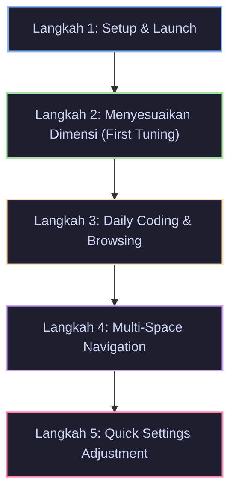

# Target User Persona & User Journey

**Project Name:** YAN (*YAN Another Notch*)  
**Target Platform:** macOS  

---

## 1. User Persona

### 🧑‍💻 Primary Persona: The Aesthetic Minimalist & Power Hacker

```yaml
Name: "Alex 'Revy' Pratama"
Age: 25
Device: MacBook Air M1 (13-inch, macOS Sequoia)
Occupation: Full-stack Developer & Indie Builder
Personality: Tech-savvy, minimalist, detail-oriented, hates screen clutter.
```

#### Motivations
- Menyukai estetika hardware Apple modern (seperti MacBook Pro notch & iPhone Dynamic Island), namun enggan ganti laptop karena performa M1 Air masih sangat bertenaga.
- Menyukai aplikasi yang *stealth*: bekerja di latar belakang tanpa memenuhi icon bar di menu bar atau dock.
- Ingin memiliki ruang interaktif di bagian atas layar yang nantinya bisa diekspansi menjadi widget hub pribadinya.

#### Pain Points
- Bezel atas MacBook Air M1 datar dan terkesan polos/statis.
- Menu bar macOS sering kali penuh oleh ikon utilitas pihak ketiga (Docker, Slack, Raycast, Bluetooth, Battery, dll.), sehingga aplikasi baru yang menambah ikon menu bar sangat mengganggu (*clutter*).
- Utilitas pihak ketiga sejenis sering terasa lambat, boros memori (Electron-based), atau crash saat berganti desktop space.

#### Core Needs
- Aplikasi native yang sangat ringan dan tidak menyedot daya baterai saat coding seharian di cafe.
- Notch virtual yang ukurannya bisa di-tweak pas dengan lebar dan tinggi yang diinginkan secara presisi.
- Kontrol penuh atas interaksi (apakah aktif saat disentuh kursor, atau saat diklik).

---

## 2. User Journey Map



| Tahapan Journey | Aksi Pengguna | Respons Sistem (YAN) | Emosi / Pengalaman Pengguna |
| :--- | :--- | :--- | :--- |
| **1. Setup & Launch** | Menjalankan aplikasi YAN untuk pertama kali. | Notch virtual muncul di tengah atas layar; jendela **Settings** terbuka otomatis untuk onboarding awal. | *"Keren, tidak ada ikon baru yang menjejali menu bar saya!"* |
| **2. First Tuning** | Menggeser slider *Width*, *Height*, dan *Corner Radius*. | Bentuk notch di atas layar berubah secara *real-time* mengikuti posisi slider. | *"Sangat mulus dan presisi. Saya bisa sesuaikan tingginya pas dengan tinggi menu bar."* |
| **3. Daily Usage** | Bekerja di VS Code / Safari; mengarahkan kursor ke atas layar. | Notch mendeteksi hover dan mengembang (*spring expansion*) dengan halus. | *"Terasa seperti fitur bawaan macOS yang hidup dan dinamis."* |
| **4. Space Navigation**| Melakukan swipe 3-jari untuk berpindah antar Desktop Spaces. | Notch tetap menempel kokoh (*stationary*) di posisinya tanpa berkedip atau ikut bergeser. | *"Solid. Tidak ada artefak visual aneh saat swipe layar."* |
| **5. Settings Access** | Ingin mengubah mode trigger: klik kanan pada notch atau tekan `Cmd + Shift + ,`. | Panel Settings muncul seketika di tengah layar. | *"Navigasi sangat efisien tanpa perlu mencari ikon di menu bar."* |
