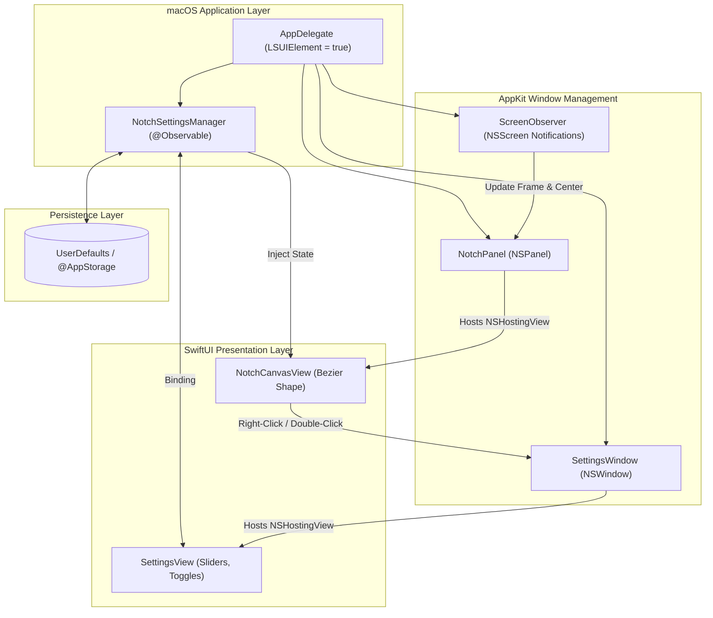

# System Architecture & Technical Specifications

**Project Name:** YAN (*YAN Another Notch*)  
**Architecture Pattern:** Clean MVVM with AppKit-SwiftUI Hybrid Bridge  
**Last Updated:** 2026-11-10  

---

## 1. Tech Stack Overview

| Layer | Technology | Justification |
| :--- | :--- | :--- |
| **Language** | Swift 5.9+ / Swift 6 | Bahasa resmi ekosistem Apple, memory safe, performa bare-metal. |
| **UI Framework** | SwiftUI | Komposisi deklaratif, state binding instan, animasi *spring* fluid. |
| **Window Host** | AppKit (`NSPanel` / `NSWindow`) | Membutuhkan kemampuan tingkat rendah macOS window server (transparansi, non-activating, space joining). |
| **State Persistence**| `UserDefaults` (`@AppStorage`) | Penyimpanan konfigurasi lokal instan tanpa overhead database eksternal. |
| **Event System** | `NSTrackingArea` & `NSEvent` | Deteksi posisi pointer mouse akurat di level window coordinate. |
| **Lifecycle** | `NSApplicationDelegate` (`LSUIElement`) | Berjalan sebagai agen latar belakang (tanpa dock icon dan menu bar icon). |

---

## 2. High-Level System Architecture Diagram



---

## 3. Core Architectural Components

### 3.1 `NotchPanel` (Custom `NSPanel`)
Untuk mencapai efek overlay yang melayang di atas seluruh aplikasi tanpa mencuri fokus (*focus stealing*), `NotchPanel` dikonfigurasi dengan atribut khusus:
- **Style Mask:** `[.borderless, .nonactivatingPanel]`
- **Level:** `.mainMenu + 1` atau `.floating` (agar tetap berada di layer paling atas, sejajar atau di atas Menu Bar).
- **Collection Behavior:** `[.canJoinAllSpaces, .stationary, .fullScreenAuxiliary]`
  - `.canJoinAllSpaces`: Menjamin jendela notch tetap eksis di semua Desktop Space tanpa reload.
  - `.stationary`: Mencegah jendela ikut bergerak ke samping saat transisi Mission Control / 3-finger swipe.
  - `.fullScreenAuxiliary`: Memungkinkan notch tetap terlihat saat aplikasi lain berada dalam mode native full-screen.
- **Background:** `NSColor.clear`, `isOpaque = false`, `hasShadow = false`.

### 3.2 `NotchCanvasView` (SwiftUI Presentation)
Menangani rendering visual bentuk fisik notch:
- **Shape Generation:** Menggunakan `Path` kustom dengan kurva Bezier kontinu (*Continuous Corner Curve / Squircle*) untuk mereplikasi lekukan notch khas Apple.
- **State Handling:**
  - `isHovered`: Memicu transisi *Spring Animation* (misal: penambahan tinggi dan lebar sebesar 15–25%).
  - `isExpanded`: State saat pengguna mengklik atau memicu mode ekspansi penuh.
- **Context Menu Interaction:** Menangani gesture klik kanan untuk langsung memanggil `SettingsWindowController.shared.show()`.

### 3.3 `NotchSettingsManager` (State Controller)
Menggunakan paradigma `@Observable` (atau `ObservableObject` di iOS 16/macOS 13) yang tersambung dengan `UserDefaults`:
- Properti:
  - `notchWidth: Double` (default: 180.0)
  - `notchHeight: Double` (default: 32.0)
  - `cornerRadius: Double` (default: 14.0)
  - `expandOnHover: Bool` (default: true)
  - `expandOnClick: Bool` (default: false)
  - `showOnAllDisplays: Bool` (default: false)
  - `showInFullScreen: Bool` (default: true)

---

## 4. Screen Geometry & Alignment Logic

Notch virtual harus selalu berada tepat di tengah horizontal layar atas:

```swift
func updateNotchPosition(for screen: NSScreen, width: CGFloat, height: CGFloat) {
    let screenFrame = screen.frame
    let originX = screenFrame.origin.x + (screenFrame.width - width) / 2
    let originY = screenFrame.origin.y + screenFrame.height - height
    
    let targetFrame = NSRect(x: originX, y: originY, width: width, height: height)
    self.setFrame(targetFrame, display: true, animate: false)
}
```

Sistem mendengarkan notifikasi `NSApplication.didChangeScreenParametersNotification` agar saat resolusi layar berubah atau kabel monitor eksternal dicabut, notch otomatis melakukan rekalkulasi posisi (*re-center*).

---

## 5. Security & Privacy Considerations
- **Sandboxing:** Aplikasi dapat berjalan di dalam App Sandbox karena tidak memerlukan akses filesystem privat, hanya manipulasi window overlay lokal dan `UserDefaults`.
- **Zero Input Monitoring:** YAN pada mode standar tidak memerlukan izin *Accessibility* (*AXIsProcessTrusted*) atau *Input Monitoring* karena tracking hover dilakukan murni melalui `NSTrackingArea` di dalam batas kanvas jendela overlay-nya sendiri.
