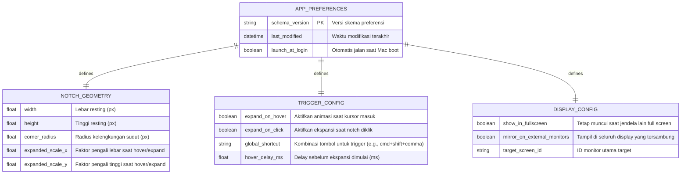

# State Storage & Preferences Data Model

**Project Name:** YAN (*YAN Another Notch*)  
**Storage Engine:** macOS `UserDefaults` (Standard Key-Value Store)  
**Serialization:** Native Swift `Codable` & `@AppStorage` Property Wrappers  
**Last Updated:** 2026-11-10  

---

## 1. Entity-Relationship & State Model

Meskipun YAN tidak membutuhkan database relasional SQL (karena merupakan utilitas lokal *low-latency*), struktur model data preferensi dirancang modular dan terisolasi per domain tanggung jawab:



---

## 2. Data Dictionary

### Key Space: `com.yan.notchanothernotch.preferences`

| Key / Property | Tipe Data | Nilai Default | Valid Range | Deskripsi |
| :--- | :--- | :--- | :--- | :--- |
| `notchWidth` | `Double` | `180.0` | `100.0` – `360.0` | Lebar dasar notch dalam poin layar (*points*). |
| `notchHeight` | `Double` | `32.0` | `20.0` – `54.0` | Tinggi notch dasar (disesuaikan dengan tinggi menu bar MacBook M1). |
| `cornerRadius` | `Double` | `14.0` | `4.0` – `28.0` | Kelengkungan sudut bawah kiri dan kanan notch. |
| `expandOnHover` | `Bool` | `true` | `true / false` | Menentukan apakah notch mengembang otomatis saat mouse menyentuh area. |
| `expandOnClick` | `Bool` | `false` | `true / false` | Membuka ekspansi penuh hanya jika diklik. |
| `showInFullScreen`| `Bool` | `true` | `true / false` | Menjaga jendela notch tetap tampil saat desktop beralih ke native fullscreen. |
| `multiMonitorEnabled`| `Bool` | `false` | `true / false` | Jika `false`, notch hanya dibuat pada layar primer (`NSScreen.main`). |
| `hoverDelayMs` | `Double` | `120.0` | `0.0` – `500.0` | Waktu jeda agar tidak sengaja mengembang saat kursor sekadar lewat cepat. |

---

## 3. Swift Implementation Schema

Kode model berikut siap diimplementasikan langsung ke dalam arsitektur aplikasi:

```swift
import Foundation
import SwiftUI

/// Representasi model konfigurasi utama YAN
public struct NotchPreferences: Codable, Equatable {
    public var width: Double = 180.0
    public var height: Double = 32.0
    public var cornerRadius: Double = 14.0
    
    public var expandOnHover: Bool = true
    public var expandOnClick: Bool = false
    public var hoverDelayMs: Double = 120.0
    
    public var showInFullScreen: Bool = true
    public var multiMonitorEnabled: Bool = false
    public var launchAtLogin: Bool = false
    
    public static let `default` = NotchPreferences()
}

/// Observable Store yang bertindak sebagai Single Source of Truth
@MainActor
public final class NotchSettingsStore: ObservableObject {
    public static let shared = NotchSettingsStore()
    
    private let userDefaultsKey = "com.yan.notchanothernotch.settings"
    
    @Published public var preferences: NotchPreferences {
        didSet {
            save()
        }
    }
    
    private init() {
        if let data = UserDefaults.standard.data(forKey: userDefaultsKey),
           let decoded = try? JSONDecoder().decode(NotchPreferences.self, from: data) {
            self.preferences = decoded
        } else {
            self.preferences = .default
        }
    }
    
    public func save() {
        if let encoded = try? JSONEncoder().encode(preferences) {
            UserDefaults.standard.set(encoded, forKey: userDefaultsKey)
        }
    }
    
    public func resetToDefaults() {
        self.preferences = .default
    }
}
```
